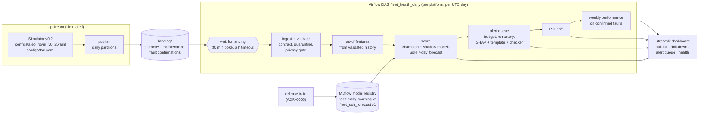

# ingen_fleet_health v1.0 — Robot Fleet Telemetry Analytics & Predictive Health

[](https://github.com/Kuntong705/ingen-robot-telemetry/actions/workflows/ci.yml)

> **Everything here is synthetic.** The robots, telemetry, faults, maintenance notes, costs and the Fari profile are simulated from documented assumptions (`configs/*.yaml`). No InGen telemetry, customer data, personal data or confidential material is in this repository. No result has been validated on a real robot.

A reproducible fleet-health analytics package for InGen robot platforms. The primary platform is the Aido Rover outdoor patrol robot; the secondary is the Fari indoor companion. It is built over a four-week internship (Plan v3.0) and answers one operator question: **which robots should be pulled before the next shift, and why?**

| Layer | What it does | Where |
|---|---|---|
| Simulator v0.2 | Physics-grounded, seeded fleet: battery fade and resistance, motor heating, terrain, vibration, P-F fault timelines, drift, outages | `src/ingen_fleet_health/simulate/`, `configs/` |
| Data contract and ingestion | Schema, physical-range, timestamp and odometer rules; quarantine with reasons; platform profiles; Fari privacy gate | `ingest_pipeline.py`, `contract.py`, `docs/W01_Data_Contract.md` |
| Features | As-of rolling and physics features, environment-normalised | `features/`, `docs/W02_Feature_Registry.md` |
| Evaluation | Unit-grouped walk-forward with embargo; operator metrics (alert budget, lead time, false alarms per unit-week) | `evaluation/`, ADR-0004 |
| Models | SoH forecasting; 72 h fault early warning; text classifier and fusion (Week 3) | `models/` |
| Explanations | Tree SHAP evidence packs, template summaries, faithfulness checker | `explain/` |
| Daily pipeline (v1) | landing → validate → features → score → predictions → alert queue → PSI and weekly performance | `pipeline/`, `monitoring/`, ADR-0005, ADR-0006 |
| Orchestration | Airflow DAG `fleet_health_daily`, Docker Compose (Airflow, MLflow registry, dashboard) | `pipelines/airflow/dags/`, `docker-compose.yml` |
| Dashboard | Streamlit + Plotly: pull list, unit drill-down, alert queue, model and data health | `dashboard/`, ADR-0007 |

## Architecture



Every partition (`<table>/platform=<p>/date=<d>/`) is written atomically and re-written identically on a re-run (ADR-0006).

## Requirements

- **Docker path (recommended for the quickstart):** Docker Desktop or Docker Engine with Compose v2. About 15 GB of free disk for the images, and 8 GB of RAM for Docker.
- **Local path:** Python 3.11 and [uv](https://docs.astral.sh/uv/) (`pip install uv`). On Windows, use `py -3.11 -m uv` wherever `uv` appears below.

## Quickstart (fresh clone → running DAG and dashboard)

Every command runs from the repository root. The expected outcome follows each step.

1. **Clone.** `git clone https://github.com/Kuntong705/ingen-robot-telemetry.git && cd ingen-robot-telemetry`
   - Outcome: a working tree with `docker-compose.yml` at the root.
2. **Build the images.** `docker compose build`
   - Outcome: images `ingen-fleet-health:app` and `ingen-fleet-health:airflow`. The first build takes about 7 minutes.
3. **Start the model registry.** `docker compose up -d mlflow`
   - Outcome: MLflow at http://localhost:5000, and the container reports `healthy`.
4. **Build data, train, register, publish and backfill.** `docker compose run --rm trainer`
   - Outcome: two small synthetic fleets (12 robots × 40 days per platform) are simulated, validated and featurised.
   - `fleet_early_warning` v1 and `fleet_soh_forecast` v1 are registered in MLflow.
   - The daily landing partitions are published, and every date is processed (ingest and features for the training window, all steps after the cut-off).
   - This takes about 15–25 minutes. The log ends with `backfill done … (scored from 2026-11-19)`.
5. **Start Airflow and the dashboard.** `docker compose up -d airflow dashboard`
   - Outcome: the dashboard is at http://localhost:8501 and opens on the "Pull list (next shift)" tab with the robots to pull and why.
   - Airflow is at http://localhost:8080. User `admin`; the password is in `docker compose logs airflow | grep -i password`.
   - The DAG `fleet_health_daily` is listed and paused.
6. **Run the DAG for one day.** `docker compose exec airflow airflow dags test fleet_health_daily 2026-12-05`
   - Outcome: both platform groups succeed for UTC day 2026-12-04. That date is already processed, so the re-run replaces its partitions with byte-identical files.
7. **Backfill through Airflow (optional).** `docker compose exec airflow airflow dags unpause fleet_health_daily`, then `docker compose exec airflow airflow backfill create --dag-id fleet_health_daily --from-date 2026-11-21 --to-date 2026-11-22`
   - Outcome: two backfill runs, executed one at a time; `airflow dags list-runs fleet_health_daily` shows them as `success`.
   - Airflow refuses backfills of logical dates in the future, and the simulated fleets run into December 2026. For dates after the real current date, use `airflow dags test` or the CLI backfill.

The quickstart fleet is a plumbing demo with 12 robots per platform; its numbers are not an evaluation. To stop everything: `docker compose down` (add `-v` to delete the data volume).

### Local path (no Docker; Windows, macOS or Linux)

```bash
uv sync --locked
uv run python -m ingen_fleet_health.release.quickstart --root data/quickstart --all   # same as step 4
FLEET_PIPELINE_CONFIG=data/quickstart/pipeline.yaml uv run streamlit run dashboard/app.py
```

Airflow does not run natively on Windows. There, run the pipeline with its CLI, which the DAG calls step by step:

```bash
uv run python -m ingen_fleet_health.pipeline run --date 2026-12-04            # one date, all steps, all platforms
uv run python -m ingen_fleet_health.pipeline backfill --start 2026-12-01 --end 2026-12-04
uv run python -m ingen_fleet_health.pipeline status                           # landed / scored / stale dates
```

## Regenerate the full study data and train

The full fleets are 50 robots × 60 days per platform, about 4.3 M minute records each. All of it is git-ignored and regenerated from configs and seeds.

```bash
# Week 2: Rover fleet, features, evaluations (about 25 min)
uv run python -m ingen_fleet_health.simulate.fleet --out-dir data/w02 --units 50 --days 60
uv run python -c "from ingest_pipeline import run_pipeline; run_pipeline('data/w02/generated/fleet_telemetry.csv', out_root='data/w02')"
uv run python -m ingen_fleet_health.features.build --data-dir data/w02
uv run python -m ingen_fleet_health.experiments.leakage_demo --data-dir data/w02
uv run python -m ingen_fleet_health.experiments.soh_run --data-dir data/w02
uv run python -m ingen_fleet_health.experiments.early_warning_run --data-dir data/w02
# Week 3: text corpus, fusion, explanations, Fari (about 1.5 h on 16 cores); commands in weekly/W03_Progress.md
uv run python -m ingen_fleet_health.simulate.fleet --out-dir data/w03_fari --config configs/fari.yaml
uv run python ingest_pipeline.py --input data/w03_fari/generated/fleet_telemetry.csv --out-root data/w03_fari --platform-config configs/fari.yaml
uv run python -m ingen_fleet_health.features.build --data-dir data/w03_fari --config configs/fari.yaml
# Week 4: production v1 (configs/pipeline.yaml), daily partitions, history load, scoring
uv run python -m ingen_fleet_health.release.train                     # registers the next version of both models
uv run python -m ingen_fleet_health.pipeline.publish                  # landing partitions for both platforms
uv run python -m ingen_fleet_health.pipeline backfill --start 2026-10-26 --end 2026-11-24 --steps ingest,features
uv run python -m ingen_fleet_health.pipeline backfill --start 2026-11-25 --end 2026-12-24
uv run python scripts/build_w04_evidence.py && uv run python -m ingen_fleet_health.release.cost_benefit
uv run python scripts/build_w04_docs.py
uv run mlflow ui --backend-store-uri sqlite:///mlflow.db               # every run and registered model
```

Bumping the registry version does not change serving: the pipeline loads the version pinned in `configs/pipeline.yaml`.

## Running the DAG

- **Schedule.** 02:00 UTC daily processes the previous UTC day. The 2 hours are a grace period for late uploads.
- **Tasks, per platform:** `wait_landing → ingest → features → score → alerts → drift`, then `weekly_performance`. The weekly task does work on Sundays only.
- **Backfill.** `airflow backfill create --dag-id fleet_health_daily --from-date <D+1> --to-date <E+1>`, or without Airflow `python -m ingen_fleet_health.pipeline backfill --start D --end E`. Dates run oldest first. Model steps are skipped for dates inside the training window.
- **Late or missing partition (ADR-0006).** The sensor waits up to 6 hours, polling every 30 minutes. Then:
  - the platform's tasks fail and nothing is written for that platform and date;
  - the other platform still runs;
  - the failure is recorded, and the dashboard shows the gap.

  When the data arrives, backfill from that date onwards; `pipeline status` lists the stale dates.
- **Idempotency.** Re-running a date produces byte-identical partitions. This is tested in pytest and was checked through Airflow (`reports/w04/docker_airflow_checks.json`).
- **Run outcome.** The leaf task `all_platforms_ok` fails the run when any platform failed, so a missing partition is never reported as a successful run.

## Results

All results are on synthetic fleets. The protocols are leakage-safe: unseen robots, time-ordered, embargoed. 95 % confidence intervals resample whole robots.

### Week 1 — data quality (20 Rover units × 60 days)

| Run | Records | Accepted | Rejected | Missing minutes | Quality passed |
|---|---:|---:|---:|---:|---|
| Clean baseline | 1,728,000 | 1,728,000 | 0 | 0 | True |
| Seeded network impairments | 1,719,514 kept of 1,728,000 | 1,719,514 | 0 | 8,486 | False (expected) |

### Week 2 — features, leakage-safe evaluation, health models (50 Rover units)

| Track | Baselines | Models | Result |
|---|---|---|---|
| SoH forecast, MAE (pp) at 1 / 7 / 14 d | persistence 0.34 / 0.44 / 0.67; linear 0.31 / 0.39 / 0.50 | LightGBM 0.26 / 0.31 / 0.41; LSTM 0.27 / 0.40 / 0.52 | LightGBM beats persistence at every horizon and linear at 7 and 14 d; the LSTM does not beat linear |
| 72 h early warning, PR-AUC (base rate 0.055) | physics rule 0.215 | LightGBM 0.210; Isolation Forest 0.330 | Isolation Forest is best (significant vs both); LightGBM does not beat the physics rule |
| Leakage demo, PR-AUC | — | same LightGBM | random shuffle 0.999 vs proper protocol 0.261 |
| External: NASA C-MAPSS FD001, test RMSE in **cycles** (capped truth) | constant 41.94; age-linear 37.00 | LightGBM 13.09 (3 seeds 13.07 ± 0.01); LSTM 14.38 (14.29 ± 0.20) | inside the published range (CNN 18.45, Deep LSTM 16.14, DCNN ≈ 12.6); a different task from SoH, not comparable numerically |

### Week 3 — maintenance text, fusion, explanations, Fari

| Track | Baseline | Models | Result |
|---|---|---|---|
| Ticket classifier, macro-F1 (917 held-out tickets, 7 classes) | majority 0.108 | TF-IDF + LR 0.846; embeddings + LR 0.863; both 0.868 | both − TF-IDF +0.022 [0.007, 0.039]; unseen wording 0.481; early symptom notes are mostly read as 'no fault found' |
| Fusion, 72 h early warning PR-AUC (base rate 0.055) | LightGBM 0.210; Isolation Forest 0.330 | text only 0.059; early fusion 0.226; late stacked 0.226 | early − LightGBM +0.016 [-0.040, 0.078] (not detectable); text stacked on Isolation Forest -0.153 (worse); at 4x operator notice rate early − LightGBM +0.130 [0.044, 0.230] |
| Alert summaries, faithful on 20 sampled alerts | — | template; local Qwen2.5-1.5B | template 20/20 automatic, 20/20 on reading; LLM 8/20 automatic, 0/20 in the AI-assisted evidence review; checker flags 79/79 corrupted summaries |
| Fari transfer (synthetic profile), Rover LightGBM PR-AUC on Fari | as-is 0.046; contract acceptance 0 % | platform profile + feature guards 0.157; Fari-trained 0.151 | minimal change +0.111 [0.034, 0.189]; acceptance 100 %; per-platform threshold needed |

### Week 4 — production v1 in the daily pipeline (operational period, held-out robots)

<!-- W04_RESULTS -->
Production v1 (`fleet_early_warning` v1, `fleet_soh_forecast` v1) scored by the daily pipeline from 2026-11-25 to 2026-12-24. Held-out robots were never seen in training. This is one time cut and one unit split (ADR-0005), a different protocol from the Week 2 walk-forward, with wide intervals. Source: `reports/w04/operational_results.json`.

| Platform | Early warning PR-AUC, held-out [95 % CI] | Shadow: Isolation Forest / physics rule | Champion - IF [95 % CI] | Alert queue (held-out): onsets caught, precision, false alarms per robot-week | SoH 7-day MAE (pp): model vs persistence |
|---|---|---|---|---|---|
| Aido Rover | 0.370 [0.088, 0.646] (base rate 0.051) | 0.534 / 0.303 | -0.164 [-0.409, 0.055] | 5/6, 0.10, 0.94 | 0.275 vs 0.436 |
| Fari | 0.160 [0.029, 0.533] (base rate 0.056) | 0.075 / 0.061 | +0.085 [-0.016, 0.382] | 5/6, 0.09, 1.05 | 0.314 vs 0.454 |

- **Explanations.** Every production alert carries a template summary, and the checker found every statement supported in Aido Rover 209/209, Fari 223/223.
- **Cost-benefit (model card §8).** Acting on alerts pays off only if (failure cost - planned repair) / false-alarm cost exceeds the break-even ratio of Aido Rover 8.8, Fari 9.6 for held-out robots. At the placeholder costs the ratio is 5.8, so the net is negative. InGen's real costs decide this.
- **Drift.** Most feature-days are in the 'shift' band (simulated seasonal cooling); see the model card §5.
- **Quality gates.** See `reports/w04/quality_gates.json` and `reports/w04/docker_airflow_checks.json`.
<!-- /W04_RESULTS -->

## Known limitations

- **Synthetic only.** Simulator physics, fault mix, noise, the Fari profile, the operator-note rate and all costs are assumptions. The conclusions need re-validation on real InGen telemetry and confirmed tickets.
- **Early warning is weak, and the champion is not the best ranker on Rover.**
  - LightGBM does not beat the physics rule on Rover (Week 2).
  - The Isolation Forest, kept as a shadow model, ranks better on Rover.
  - The champion was kept for its explanations and its Fari transfer (ADR-0005).
- **Few faults, wide intervals.** About 40 onsets per 50 robots in 60 days. Weekly checks usually say "insufficient labels".
- **Text adds nothing detectable** at the assumed note rate. The local LLM was not faithful (0/20), so production uses template explanations only.
- **Calibration is overconfident** at the top end. Read the risk as a ranking.
- **Drift.** The simulated weather cools over the period, and the PSI shows drift on several top features.
- **Operations.** Daily feature cost grows with history. Airflow runs standalone (SQLite) in Compose. The dashboard has no authentication. Python 3.11 only.

## Next steps

1. **Re-validate on real InGen data.** Use 3–6 months of Aido Rover telemetry and confirmed tickets; measure real note coverage and the fault mix; re-run the Week 2 protocol.
2. **Champion–challenger decision with real costs.** Use the weekly checks to choose the alerting model per platform: the Isolation Forest shadow vs the LightGBM champion.
3. **Pilot the alert queue with a Sentinel Prime AI operations team**, with an agreed alert budget and false-alarm cost. Then extend the data contract to Aido Humanoid joint telemetry.

## Documentation

| Week | Deliverables |
|---|---|
| 1 | `docs/W01_Fleet_Data_Brief.docx`, `docs/W01_Data_Contract.md`, `docs/W01_Simulator_Assumptions.md`, `reports/W01_Data_Quality_Report.json`, `weekly/Wk-01-Log.md` |
| 2 | `docs/W02_Feature_Registry.md`, `docs/W02_Evaluation_Protocol.docx`, `docs/W02_Model_Results.docx`, `weekly/Wk-02-Log.md` |
| 3 | `docs/W03_Report.docx`, `docs/W03_Log_Corpus.md`, `docs/W03_Fusion_Results.docx`, `docs/W03_Alert_Explanations.md`, `docs/W03_Fari_Gap_Analysis.docx`, `weekly/Wk-03-Log.md`, `reports/w03/llm_faithfulness_review.json` (AI-assisted evidence review) |
| 4 | `docs/W04_Model_Card.docx`, `docs/W04_Capstone_Deck.pdf`, `docs/W04_Retrospective.docx` (reflection sections left for the intern), `docs/W04_Demo_Script.md`, `reports/w04/*.json`, `weekly/Wk-04-Log.md` |

**Architecture decision records** (`docs/adr/`; originals are preserved, and revisions are dated at the end of each file):

| ADR | Decision | Revisions |
|---|---|---|
| 0001 | Analytical store: DuckDB + Parquet | Week 4 note: daily Parquet partitions |
| 0002 | Wide telemetry table | Week 4 addendum: partitioned by platform and date |
| 0003 | Label: qualifying fault onset within 72 h | rev1 (Week 2): P-F timeline, exclusions; Week 4: unchanged |
| 0004 | Leakage-safe evaluation protocol | — |
| 0005 | Production recipe: pooled LightGBM champion, shadow models, registry | new in Week 4 |
| 0006 | Daily pipeline: partitions, idempotency, backfill, late and missing data, monitoring | new in Week 4 |
| 0007 | Dashboard technology: Streamlit + Plotly | new in Week 4 |

Progress logs and hand-over notes: `weekly/W02_Progress.md`, `weekly/W03_Progress.md`, `weekly/W04_Progress.md`.

## Quality gates

CI (`.github/workflows/ci.yml`) runs ruff, mypy, pytest with coverage, a gitleaks scan of the full history, and a Docker image build with a smoke test. `python scripts/run_w04_gates.py` runs the same gates locally and records the results in `reports/w04/quality_gates.json`.

## Data governance and licence

Synthetic code, documentation, tests and approved demonstration artefacts only. Generated data, MLflow stores and videos are git-ignored. No credentials are needed; `.env.example` lists the optional settings. MIT licence (`LICENSE`); third-party data, models and software are attributed in `NOTICE`. Contribution rules are in `CONTRIBUTING.md`.
