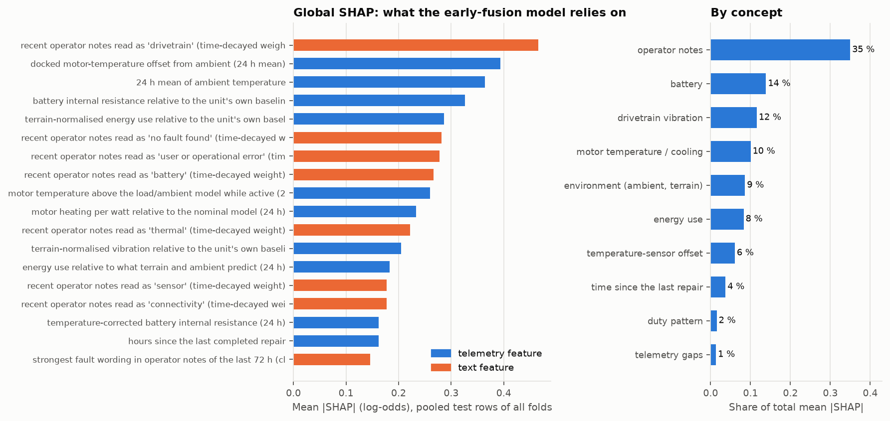
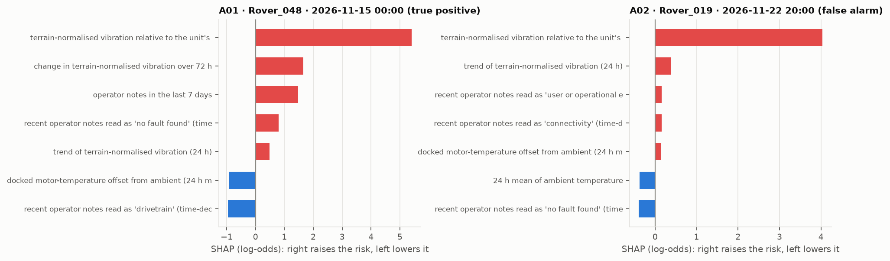

# W03 — Alert Explanations: SHAP, Grounded Summaries and Faithfulness

*Week 3 deliverable 3 · generated by scripts/build_w03_docs.py from reports/w03/alert_explanations.json and manual_faithfulness.json · MLflow run b01f56c899314e2c94a1b12a3766eb2b*

> **SYNTHETIC DATA.** Units, telemetry, alerts and operator notes are simulated. Summaries were written by a deterministic template and by a local open-weights LLM on this machine; **no hosted LLM API was called** and no data left the machine.

## 1. What is explained

- Model: early_fusion (LightGBM on telemetry + text features, variant chosen on validation). It is the only arm whose inputs include both telemetry and text, so an attribution can point at a linked note. Each fold's model explains only its own unseen test robots (41,970 rows).
- Method: TreeExplainer, exact tree SHAP, raw margin (log-odds) of the uncalibrated model. Additivity check: max |sum(SHAP) + base − raw margin| = 4.1e-14.
- Calibration is monotone, so the sign and ranking of contributions carry over to the calibrated risk shown to the operator; SHAP values are log-odds, not probability points.
- Refitting reproduces the fusion run's out-of-fold early-fusion scores to within 0.0e+00, so the explained model is the evaluated model.

## 2. Global SHAP



*Mean |SHAP| per feature (left) and share by concept (right), pooled test rows of all folds.*

| Rank | Feature | Concept | Mean \|SHAP\| |
|---|---|---|---|
| 1 | `txt_decay_drivetrain` | operator_notes | 0.4660 |
| 2 | `motor_temp_resid_dock_mean_24h` | sensor_drift | 0.3940 |
| 3 | `ambient_mean_24h` | environment | 0.3640 |
| 4 | `r_hat_ratio_to_baseline` | battery | 0.3264 |
| 5 | `energy_ratio_to_baseline` | energy | 0.2868 |
| 6 | `txt_decay_no_fault_found` | operator_notes | 0.2813 |
| 7 | `txt_decay_user_or_operational_error` | operator_notes | 0.2780 |
| 8 | `txt_decay_battery` | operator_notes | 0.2669 |
| 9 | `motor_temp_resid_patrol_mean_24h` | thermal | 0.2594 |
| 10 | `thermal_gain_ratio_24h` | thermal | 0.2328 |
| 11 | `txt_decay_thermal` | operator_notes | 0.2219 |
| 12 | `vib_norm_ratio_to_baseline` | vibration | 0.2048 |

Share of total mean |SHAP| by concept: operator_notes 35 %, battery 14 %, vibration 12 %, thermal 10 %, environment 9 %, energy 8 %, sensor_drift 6 %, maintenance_history 4 %, usage 2 %, data_quality 1 %. Text features together carry **36.2 %** of the attribution mass, although adding them gives no detectable PR-AUC gain over telemetry (W03_Fusion_Results). Attribution share measures how much the model *uses* a feature, not how much it *helps*: the trees split on text features, often at near-zero values (alerts A09, A10, A12), which is fitting noise rather than signal. This is a concrete reason not to read a SHAP ranking as evidence that a modality is valuable.

## 3. Per-alert SHAP and the evidence pack



*Per-alert SHAP for one true-positive alert and one false alarm (right: raises the risk).*

Each alert is summarised from an **evidence pack** and nothing else: unit, time, calibrated risk and threshold; the top five SHAP attributions pushing the risk up and the two strongest pushing it down, each with its value now and 72 h earlier; and the unit's operator notes / service tickets created in the 7 days before the alert, with the fold classifier's reading of each (never the label). Two generators write from the same pack:

- **Template** — deterministic, can only verbalise pack fields. It quotes a note only when that note feeds the attributed text feature (`note_behind`), and qualifies a ratio within 2 % of 1 as 'essentially at the reference level'.
- **Local LLM** — `Qwen/Qwen2.5-1.5B-Instruct` (Apache-2.0, CPU, greedy decoding) given the system and user prompt below. It writes free prose, so it *can* invent a cause or a number; the check measures how often it does.

Prompt for alert A01 (the exact text the LLM saw; a hosted provider would receive the same):

```text
EVIDENCE
Unit: Rover_048. Alert time: 2026-11-15 00:00 UTC.
Model risk of a qualifying fault onset within 72 h: 21 %. Alert threshold: 8.2 %.
Features pushing the risk UP (strongest first):
- terrain-normalised vibration relative to the unit's own baseline at 1.49 x baseline (1.12 x baseline 72 h earlier)
- change in terrain-normalised vibration over 72 h at 0.0673 g (0.0185 g 72 h earlier)
- operator notes in the last 7 days at 4.00 (1.00 72 h earlier)
Features pushing the risk DOWN:
- recent operator notes read as 'drivetrain' (time-decayed weight) at 0.179 (0.293 72 h earlier)
Operator notes for this unit in the previous 7 days (newest first):
- 41.2 h before the alert: "R048 - wifi handoevr failed at the loading bay - logging for maintenance" (ticket classifier reading: connectivity)
- 59.2 h before the alert: "fyi quiet shift" (ticket classifier reading: no fault found)
Write the explanation now.
```

## 4. The faithfulness check

`explain/faithfulness.py` reads the *text* of a summary (not the generator's internals) and extracts every claim. A summary is faithful only if every claim is supported by its evidence pack:

| Claim | Supported when |
|---|---|
| feature named verbatim | the feature is in the pack, on the side (raising / lowering) the sentence states |
| cause in free wording (vibration, cooling, battery …) | the concept belongs to a feature raising the risk, or to a linked note the clause attributes it to |
| number | equals a pack value at the precision written (dates, times and the 72 h / 7 d windows are neutral) |
| quote | is a substring of a linked note or ticket |
| classifier reading | a linked note has that reading |
| notes exist / are a driver / are not | linked notes exist; a note feature is (not) among the attributions |

**Fixes made this week** to false flags found by reading the checker's output: words inside a feature phrase ('docked motor-temperature *offset*', '*lowest* state of charge') were read as direction cues for the whole sentence; the text-feature phrase "notes read as 'thermal'" was parsed as a classifier-reading claim; direction is now read per contrast segment (but / while / whereas). Two real unfaithfulness problems in the template were also fixed: it quoted the newest note even when a different note fed the attributed text feature, and it presented '1.00 x baseline' as a deviation. Each fix has a regression test in `tests/w03/test_explain.py`.

**Does the checker catch unfaithful text?** Negative controls: each faithful template summary is corrupted four ways and re-checked.

| Corruption | Built | Flagged | Detection rate |
|---|---|---|---|
| invented_cause | 19 | 19 | 100 % |
| wrong_number | 20 | 20 | 100 % |
| invented_quote | 20 | 20 | 100 % |
| reversed_direction | 20 | 20 | 100 % |
| all | 79 | 79 | 100 % |

## 5. Faithfulness rate on 20 sampled alerts

136 alerts were raised on unseen robots at 1.0 alert per unit-week (17 true positives). Sample: up to 10 true-positive alerts, the rest false alarms, drawn with a seeded generator (seed 0); 10 true positives and 10 false alarms.

| Generator | Automatic, checker v1 (as run) | Automatic, checker v2 | Claims supported (current checker) | **Manual read** |
|---|---|---|---|---|
| Template | 20/20 | 20/20 = 100 % | 246/246 | 20/20 = 100 % |
| Local LLM (Qwen2.5-1.5B-Instruct) | 3/20 | 8/20 = 40 % | 154/171 | 0/20 = 0 % |

**Headline: the template summaries are faithful (20/20 automatic and manual). The local 1.5 B LLM's summaries are not: the manual read finds a real error in every one of them, while the automatic check passes some.** The manual read (Section 6, reasons per alert) is the reference: it checks meaning, direction and arithmetic, which a lexical checker cannot.

- Verdict agreement, automatic (current checker) vs manual: 12/20.
- The checker flagged 12 LLM summaries; in 6 of them (A08, A09, A13, A15, A17, A18) a flagged claim is a real error; the others were flagged for a spurious reason while their real errors went uncaught.
- It passed 8 summaries that the manual read rejects (A01, A03, A06, A10, A14, A16, A19, A20).
- What the LLM gets wrong: risk-lowering attributions presented as concerns, values attached to the wrong feature or the wrong time (72 h earlier vs now), invented percentages and thresholds, invented causes ('wear', 'overheating'), advice the prompt forbids, and more than three sentences (often truncated).

Checker v1 → v2: after the manual read, five generic false-flag causes were fixed (US spelling 'normalized'; 'terrain-normalised' read as a terrain cause; a quoted category name read as a quote; 'no fault was found' read as a negation; the unit named as 'rover 46' read as a number), each with a test, and the stored summaries were re-scored without regeneration (MLflow f89918c62fd14cd29166177b3f313efd). Fixing false flags *raised* the LLM's automatic rate and lowered its agreement with the manual read: the checker was catching the right summaries partly for the wrong reasons. The checker was not tuned further against these summaries, to avoid fitting the evaluation to the output it evaluates.

**Conclusion for InGen.** Use the deterministic template for operator-facing alerts; it is faithful by construction and its faithfulness is verified (checker + 100 % negative-control detection + manual read). A free-text LLM layer needs a stronger model *and* a semantic check (numbers recomputed from the pack, direction per feature) before it can be trusted; a lexical checker alone is not enough for LLM prose.

## 6. The 20 alerts

### A01 · Rover_048 · 2026-11-15 00:00 UTC · true positive

Risk 20.5 % vs threshold 8.2 % · up: `vib_norm_ratio_to_baseline` +5.41; `vib_norm_change_72h` +1.65; `txt_note_count_7d` +1.48 · down: `txt_decay_drivetrain` -0.95 · linked notes/tickets: 4

**Template.** Rover_048 was flagged at 2026-11-15 00:00 UTC: the model puts the chance of a qualifying fault onset within 72 h at 21 %, against an alert threshold of 8.2 %. The score is pushed up mainly by terrain-normalised vibration relative to the unit's own baseline at 1.49 x baseline (1.12 x baseline 72 h earlier); change in terrain-normalised vibration over 72 h at 0.0673 g (0.0185 g 72 h earlier); and operator notes in the last 7 days at 4.00 (1.00 72 h earlier). An operator note written 41.2 h before the alert feeds one of these drivers: "R048 - wifi handoevr failed at the loading bay - logging for maintenance" (ticket classifier reading: connectivity).  
*Automatic: faithful · manual: faithful — All drivers, values and 72 h values match. Quotes the newest of the four notes behind the 7-day note-count driver; true, but it puts a wifi note next to a vibration alert, which over-emphasises one note.*

**Local LLM (Qwen2.5-1.5B-Instruct).** The unit Rover_048 is experiencing an elevated risk of a qualifying fault onset within the next 72 hours due to several factors. The most significant indicators are: - A 1.49x increase in terrain-normalized vibration compared to its baseline, which has been observed over the past 72 hours. - A 0.0673g change in terrain-normalized vibration over the same period, also indicating a rise. - Recent operator notes showing increased activity on the drivetrain system, with a weight of 0.179, compared to 0.293 in the 72-hour window prior. However, there are mitigating factors: - The recent operator note stating "R048 - wifi handoevr failed at the  
*Automatic: faithful · manual: NOT faithful — Lists the drivetrain-note feature (a risk-LOWERING attribution) among the indicators of elevated risk and says it shows increased activity while it fell (0.293 to 0.179). Truncated mid-sentence; more than 3 sentences.*

### A02 · Rover_019 · 2026-11-22 20:00 UTC · false alarm

Risk 5.7 % vs threshold 5.7 % · up: `vib_norm_ratio_to_baseline` +4.04; `vib_norm_slope_24h` +0.37; `txt_decay_user_or_operational_error` +0.16 · down: `txt_decay_no_fault_found` -0.39 · linked notes/tickets: 3

**Template.** Rover_019 was flagged at 2026-11-22 20:00 UTC: the model puts the chance of a qualifying fault onset within 72 h at 5.7 %, against an alert threshold of 5.7 %. The score is pushed up mainly by terrain-normalised vibration relative to the unit's own baseline (no valid reading); trend of terrain-normalised vibration (24 h) (no valid reading); and recent operator notes read as 'user or operational error' (time-decayed weight) at 0.0127 (0.180 72 h earlier). One of these drivers is derived from the unit's operator notes as a whole rather than from a single quotable note.  
*Automatic: faithful · manual: faithful — Two drivers have no valid reading; stated as such. Faithful, but not actionable for an operator.*

**Local LLM (Qwen2.5-1.5B-Instruct).** Rover_019 has a 5.7% risk of a qualifying fault onset within the next 72 hours, which is at the alert threshold. The risk is being pushed up by a combination of factors: a lack of valid terrain-normalized vibration readings, a trend showing increasing vibration over the past 24 hours, and recent operator notes indicating potential user or operational errors. These notes have a strong negative impact on the risk assessment. On the other hand, two recent operator notes suggest no fault was found, which slightly reduces the risk.  
*Automatic: UNSUPPORTED: notes 'The risk is being pushed up by a combination of factors: a l' (3 linked operator note(s) exist) · manual: NOT faithful — Invents 'a trend showing increasing vibration' (no valid reading); says user-error notes have 'a strong negative impact' while they slightly raise the risk. Checker flag is a negation-scope false flag.*

### A03 · Rover_008 · 2026-12-01 00:00 UTC · false alarm

Risk 2.1 % vs threshold 1.8 % · up: `thermal_gain_ratio_24h` +0.94; `txt_decay_connectivity` +0.93; `ambient_mean_24h` +0.57 · down: `txt_decay_user_or_operational_error` -0.69 · linked notes/tickets: 0

**Template.** Rover_008 was flagged at 2026-12-01 00:00 UTC: the model puts the chance of a qualifying fault onset within 72 h at 2.1 %, against an alert threshold of 1.8 %. The score is pushed up mainly by motor heating per watt relative to the nominal model (24 h) at 1.14 x nominal; recent operator notes read as 'connectivity' (time-decayed weight) at 0 (0.121 72 h earlier); and 24 h mean of ambient temperature at 22.4 deg C (18.6 deg C 72 h earlier). One of these drivers is an operator-note feature, and no operator note was linked to this unit in the previous 7 days.  
*Automatic: faithful · manual: faithful — Connectivity-note feature at 0 raises the risk (absence of notes); stated with its value and the 72 h value, and that no note is linked.*

**Local LLM (Qwen2.5-1.5B-Instruct).** Rover_008 has a 2.1% risk of a qualifying fault onset within 72 hours, which is above the alert threshold of 1.8%. The risk is being pushed up by several factors: high motor heating relative to nominal at 1.14x, recent operator notes indicating connectivity issues (weighting 0.121), and a recent increase in ambient temperature from 18.6°C to 22.4°C over the past 72 hours. However, there have been no recent operator notes suggesting user or operational errors, which could potentially lower the risk.  
*Automatic: faithful · manual: NOT faithful — Says notes indicate connectivity issues 'weighting 0.121': that is the value 72 h earlier; now 0 and no note is linked.*

### A04 · Rover_002 · 2026-12-04 12:00 UTC · false alarm

Risk 2.8 % vs threshold 2.3 % · up: `terrain_patrol_mean_24h` +0.10; `vib_norm_mean_6h` +0.09; `txt_service_count_7d` +0.04 · down: `motor_temp_resid_dock_mean_24h` -0.72 · linked notes/tickets: 2

**Template.** Rover_002 was flagged at 2026-12-04 12:00 UTC: the model puts the chance of a qualifying fault onset within 72 h at 2.8 %, against an alert threshold of 2.3 %. The score is pushed up mainly by mean terrain load while active (24 h) at 0.433 (0.400 72 h earlier); terrain-normalised vibration (6 h mean) at 0.174 g; and service tickets in the last 7 days at 0. The unit has 2 operator note(s) from the previous 7 days, but they are not among the main drivers of this score.  
*Automatic: faithful · manual: faithful*

**Local LLM (Qwen2.5-1.5B-Instruct).** Rover_002 is experiencing a higher-than-expected risk of a qualifying fault onset within the next 72 hours due to several factors. The mean terrain load while active has increased by 0.433 units compared to 72 hours ago, indicating potential wear on the rover's components. Additionally, the terrain-normalized vibration level has risen to 0.174 g, suggesting increased stress on the vehicle's structure. Furthermore, there have been no service tickets filed in the past seven days, which could indicate a lack of proactive maintenance. However, there are mitigating factors that may reduce the risk. The docked motor-temperature offset from ambient has decreased slightly, indicating better thermal management. The patrol was completed as planned despite heavy rain, suggesting that the  
*Automatic: UNSUPPORTED: notes 'Furthermore, there have been no service tickets filed in the' (2 linked operator note(s) exist) · manual: NOT faithful — 'Increased by 0.433 units' (0.400 to 0.433 is +0.034); invents 'wear on components', 'lack of proactive maintenance', 'better thermal management'. Checker flag (no service tickets) is a false flag: there are none.*

### A05 · Rover_046 · 2026-12-05 00:00 UTC · true positive

Risk 85.7 % vs threshold 12.5 % · up: `vib_norm_ratio_to_baseline` +6.18; `energy_ratio_to_baseline` +4.81; `motor_temp_resid_patrol_mean_24h` +0.62 · down: `txt_decay_drivetrain` -0.43 · linked notes/tickets: 3

**Template.** Rover_046 was flagged at 2026-12-05 00:00 UTC: the model puts the chance of a qualifying fault onset within 72 h at 86 %, against an alert threshold of 12 %. The score is pushed up mainly by terrain-normalised vibration relative to the unit's own baseline at 1.47 x baseline; terrain-normalised energy use relative to the unit's own baseline at 1.01 x baseline, i.e. essentially at the reference level; and motor temperature above the load/ambient model while active (24 h mean) at 1.67 deg C. The unit has 3 operator note(s) from the previous 7 days, but they are not among the main drivers of this score.  
*Automatic: faithful · manual: faithful — Energy ratio 1.01 correctly qualified as essentially at the reference level.*

**Local LLM (Qwen2.5-1.5B-Instruct).** The rover 46 is experiencing a high risk of a qualifying fault onset within the next 72 hours due to several factors. The strongest indicators are: - A significant increase in terrain-normalized vibration relative to the unit's baseline, reaching 1.47 times the baseline value. - An elevated energy use compared to the unit's baseline, with a factor of 1.01, indicating near-normal operation. - A motor temperature above the load/ambient model during active operation, at 1.67 degrees Celsius, which is above the threshold. However, there are also mitigating factors: - Recent operator notes indicate routine maintenance activities and no reported faults, with weights decaying over time. - The most recent note from 38.5 hours prior states that a  
*Automatic: UNSUPPORTED: cause 'environment: - A motor temperature above the load/ambient mo' (concept is not among the features raising the risk nor in a linked ticket); notes 'However, there are also mitigating factors: - Recent operato' (3 linked operator note(s) exist) · manual: NOT faithful — Invents 'above the threshold' for the motor-temperature excess; truncated. Checker flags are spurious ('ambient' inside a feature definition; negation).*

### A06 · Rover_018 · 2026-12-05 08:00 UTC · true positive

Risk 11.8 % vs threshold 11.8 % · up: `txt_fault_max_72h` +1.72; `r_bms_max_24h` +1.21; `txt_decay_drivetrain` +1.11 · down: `txt_decay_no_fault_found` -0.86 · linked notes/tickets: 2

**Template.** Rover_018 was flagged at 2026-12-05 08:00 UTC: the model puts the chance of a qualifying fault onset within 72 h at 12 %, against an alert threshold of 12 %. The score is pushed up mainly by strongest fault wording in operator notes of the last 72 h (classifier probability) at 0.671 (0.000998 72 h earlier); 24 h maximum of BMS-reported internal resistance at 0.0669 ohm (0.0527 ohm 72 h earlier); and recent operator notes read as 'drivetrain' (time-decayed weight) at 0.0619 (0.000445 72 h earlier). An operator note written 43.1 h before the alert feeds one of these drivers: "Rover_018 - SoH on the display went down again, not urgent" (ticket classifier reading: battery).  
*Automatic: faithful · manual: faithful — Quoted battery note is the one behind the strongest-fault-wording driver (battery is a fault class).*

**Local LLM (Qwen2.5-1.5B-Instruct).** The unit Rover_018 is at an elevated risk of experiencing a qualifying fault within the next 72 hours due to several factors. The most significant indicators are: - A strong fault was noted in the operator's notes from 72 hours ago, with a classifier probability of 0.671, suggesting a high likelihood of a fault occurring. - The BMS-reported internal resistance has been consistently low at 0.0669 ohms over the past 72 hours, compared to 0.0527 ohms previously, indicating potential issues with the vehicle's electrical system. - Recent operator notes mentioning "drivetrain" have a time-decayed weight of 0.0619, which suggests ongoing concern about drivetrain-related  
*Automatic: faithful · manual: NOT faithful — Says the fault note is 'from 72 hours ago' (it is within the last 72 h; 72 h ago the value was 0.001); calls a rising resistance 'consistently low'.*

### A07 · Rover_026 · 2026-12-05 19:00 UTC · true positive

Risk 4.9 % vs threshold 4.9 % · up: `energy_ratio_to_baseline` +1.21; `r_hat_temp_norm_24h` +0.45; `energy_ratio_to_expected_24h` +0.45 · down: `txt_decay_drivetrain` -0.90 · linked notes/tickets: 2

**Template.** Rover_026 was flagged at 2026-12-05 19:00 UTC: the model puts the chance of a qualifying fault onset within 72 h at 4.9 %, against an alert threshold of 4.9 %. The score is pushed up mainly by terrain-normalised energy use relative to the unit's own baseline at 1.00 x baseline, i.e. essentially at the reference level; temperature-corrected battery internal resistance (24 h) at 0.0426 ohm (0.0444 ohm 72 h earlier); and energy use relative to what terrain and ambient predict (24 h) at 0.952 x expected (0.951 x expected 72 h earlier). The unit has 2 operator note(s) from the previous 7 days, but they are not among the main drivers of this score.  
*Automatic: faithful · manual: faithful*

**Local LLM (Qwen2.5-1.5B-Instruct).** Rover_026 is currently experiencing a low risk of a qualifying fault onset within the next 72 hours, with a risk of 4.9%. The risk is being pushed up by several factors, including high terrain-normalized energy use compared to its baseline, a slightly higher than expected battery internal resistance, and an energy use rate that exceeds expectations based on terrain and ambient conditions. However, the risk is also being mitigated by recent operator notes indicating stable connections and no reported issues.  
*Automatic: UNSUPPORTED: cause 'environment: The risk is being pushed up by several factors,' (concept is not among the features raising the risk nor in a linked ticket); notes 'However, the risk is also being mitigated by recent operator' (2 linked operator note(s) exist) · manual: NOT faithful — Says energy use 'exceeds expectations' at 0.952 x expected and calls a 1.0009 x baseline value 'high'; says resistance is higher than expected while it fell. Checker flags are spurious.*

### A08 · Rover_001 · 2026-12-07 20:00 UTC · false alarm

Risk 16.0 % vs threshold 16.0 % · up: `txt_decay_drivetrain` +2.74; `energy_ratio_to_baseline` +1.18; `txt_decay_connectivity` +0.85 · down: `motor_temp_resid_patrol_mean_24h` -1.17 · linked notes/tickets: 6

**Template.** Rover_001 was flagged at 2026-12-07 20:00 UTC: the model puts the chance of a qualifying fault onset within 72 h at 16 %, against an alert threshold of 16 %. The score is pushed up mainly by recent operator notes read as 'drivetrain' (time-decayed weight) at 0.196 (0.00179 72 h earlier); terrain-normalised energy use relative to the unit's own baseline at 1.00 x baseline, i.e. essentially at the reference level; and recent operator notes read as 'connectivity' (time-decayed weight) at 0.0565 (0.121 72 h earlier). One of these drivers is derived from the unit's operator notes as a whole rather than from a single quotable note.  
*Automatic: faithful · manual: faithful*

**Local LLM (Qwen2.5-1.5B-Instruct).** Rover_001 is experiencing a high risk of a qualifying fault onset within the next 72 hours due to several factors. The most significant contributors are recent operator notes indicating drivetrain issues (weight factor 0.196, decaying over 72 hours), which have increased by 16% since the last assessment. Additionally, the unit's energy usage has remained relatively stable compared to its baseline, contributing only a slight increase (weight factor 0.0565). However, there are also indicators of potential problems, such as motor temperatures being slightly above normal levels (weight factor 1.49, decaying over 24 hours), which could be a cause for concern. Despite these risks, the unit's recent operator notes suggest that any  
*Automatic: UNSUPPORTED: cause 'thermal: However, there are also indicators of potential pro' (concept is not among the features raising the risk nor in a linked ticket) · manual: NOT faithful — Presents the motor-temperature excess (a risk-lowering attribution) as a concern; invents '+16 %'; attaches the connectivity-note value 0.0565 to energy use.*

### A09 · Rover_050 · 2026-12-08 12:00 UTC · false alarm

Risk 4.9 % vs threshold 4.9 % · up: `r_hat_ratio_to_baseline` +2.48; `r_hat_temp_norm_24h` +1.09; `txt_decay_thermal` +0.97 · down: `txt_decay_drivetrain` -1.22 · linked notes/tickets: 1

**Template.** Rover_050 was flagged at 2026-12-08 12:00 UTC: the model puts the chance of a qualifying fault onset within 72 h at 4.9 %, against an alert threshold of 4.9 %. The score is pushed up mainly by battery internal resistance relative to the unit's own baseline at 1.21 x baseline (1.11 x baseline 72 h earlier); temperature-corrected battery internal resistance (24 h) at 0.0486 ohm (0.0447 ohm 72 h earlier); and recent operator notes read as 'thermal' (time-decayed weight) at 0.000081 (0.000229 72 h earlier). One of these drivers is derived from the unit's operator notes as a whole rather than from a single quotable note.  
*Automatic: faithful · manual: faithful — Thermal-note feature at 0.000081 is a real driver of the model but carries no information an operator can use.*

**Local LLM (Qwen2.5-1.5B-Instruct).** Rover_050 is at risk of a qualifying fault onset within 72 hours due to an increased battery internal resistance compared to its baseline, which has risen from 0.0447 ohm to 0.0486 ohm over the past 24 hours. The temperature-corrected battery internal resistance also shows a slight increase from 0.0447 ohm to 0.0486 ohm, indicating potential thermal issues. Recent operator notes mentioning 'thermal' issues have a decaying weight of 0.000081, while 'drivetrain' issues have a decaying weight of 0.000188, suggesting these may be more relevant to the current condition.  
*Automatic: UNSUPPORTED: cause 'vibration: 'drivetrain' issues have a decaying weight of 0.0' (concept is not among the features raising the risk nor in a linked ticket) · manual: NOT faithful — Attributes the temperature-corrected resistance values to the baseline-ratio feature and to '24 hours'; invents 'thermal issues'; presents the risk-lowering drivetrain-note feature as more relevant.*

### A10 · Rover_032 · 2026-12-08 16:00 UTC · false alarm

Risk 16.0 % vs threshold 16.0 % · up: `r_hat_ratio_to_baseline` +1.92; `txt_decay_battery` +1.90; `txt_decay_no_fault_found` +1.55 · down: `vib_norm_mean_6h` -0.85 · linked notes/tickets: 1

**Template.** Rover_032 was flagged at 2026-12-08 16:00 UTC: the model puts the chance of a qualifying fault onset within 72 h at 16 %, against an alert threshold of 16 %. The score is pushed up mainly by battery internal resistance relative to the unit's own baseline at 1.23 x baseline (1.24 x baseline 72 h earlier); recent operator notes read as 'battery' (time-decayed weight) at 0.000006 (0.000024 72 h earlier); and recent operator notes read as 'no fault found' (time-decayed weight) at 0.183 (0.850 72 h earlier). One of these drivers is derived from the unit's operator notes as a whole rather than from a single quotable note.  
*Automatic: faithful · manual: faithful — Battery-note feature at 0.000006 is stated with its value; faithful to the model, misleading to read ('read as battery' with no battery note linked).*

**Local LLM (Qwen2.5-1.5B-Instruct).** Rover_032 is at high risk of a qualifying fault onset within the next 72 hours due to several factors. The battery's internal resistance has increased by 23% compared to its baseline, which is a strong indicator of potential issues. Recent operator notes mentioning 'battery' have a significant impact on the risk assessment, with a weight of 0.000006, indicating a substantial concern. Additionally, notes stating 'no fault found' have a lower but still notable weight of 0.183, suggesting ongoing operational challenges. On the other hand, the unit's recent vibration readings are within normal limits, with a mean value of 0.121 g, reducing the overall risk.  
*Automatic: faithful · manual: NOT faithful — Claims notes 'mentioning battery' (no battery note linked; feature value 0.000006) indicate 'a substantial concern'; invents 'ongoing operational challenges'.*

### A11 · Rover_041 · 2026-12-09 04:00 UTC · false alarm

Risk 13.3 % vs threshold 11.8 % · up: `vib_norm_mean_24h` +1.06; `energy_ratio_to_expected_24h` +0.70; `txt_decay_thermal` +0.67 · down: `txt_decay_no_fault_found` -0.46 · linked notes/tickets: 1

**Template.** Rover_041 was flagged at 2026-12-09 04:00 UTC: the model puts the chance of a qualifying fault onset within 72 h at 13 %, against an alert threshold of 12 %. The score is pushed up mainly by terrain-normalised vibration (24 h mean) at 0.142 g (0.143 g 72 h earlier); energy use relative to what terrain and ambient predict (24 h) at 0.986 x expected, i.e. essentially at the reference level; and recent operator notes read as 'thermal' (time-decayed weight) at 0.000147 (0 72 h earlier). One of these drivers is derived from the unit's operator notes as a whole rather than from a single quotable note.  
*Automatic: faithful · manual: faithful*

**Local LLM (Qwen2.5-1.5B-Instruct).** Rover_041 is experiencing a high risk of a qualifying fault onset within the next 72 hours due to several factors. The most significant indicators are: - A 24-hour mean terrain-normalized vibration level of 0.142 g, which is slightly above the threshold of 0.143 g observed 72 hours prior. - An energy use rate that is 0.986 times the expected value, indicating it's operating close to its baseline performance. - Recent operator notes suggesting a thermal issue, with a weight of 0.000147, which has decreased from 0.404, suggesting a potential improvement. However, there are also mitigating factors: - Recent operator notes indicate a "no  
*Automatic: UNSUPPORTED: notes 'However, there are also mitigating factors: - Recent operato' (1 linked operator note(s) exist) · manual: NOT faithful — Calls 0.142 g 'slightly above the threshold of 0.143 g' (no such threshold; 0.143 is the 72 h value); attaches the no-fault-found value 0.404 to the thermal-note feature. Checker flag is a negation false flag.*

### A12 · Rover_040 · 2026-12-11 22:00 UTC · false alarm

Risk 4.9 % vs threshold 4.9 % · up: `r_hat_ratio_to_baseline` +2.43; `txt_decay_thermal` +1.03; `txt_decay_no_fault_found` +0.82 · down: `txt_decay_drivetrain` -0.71 · linked notes/tickets: 3

**Template.** Rover_040 was flagged at 2026-12-11 22:00 UTC: the model puts the chance of a qualifying fault onset within 72 h at 4.9 %, against an alert threshold of 4.9 %. The score is pushed up mainly by battery internal resistance relative to the unit's own baseline at 1.22 x baseline (1.15 x baseline 72 h earlier); recent operator notes read as 'thermal' (time-decayed weight) at 0.000066 (0.000187 72 h earlier); and recent operator notes read as 'no fault found' (time-decayed weight) at 0.271 (0.959 72 h earlier). One of these drivers is derived from the unit's operator notes as a whole rather than from a single quotable note.  
*Automatic: faithful · manual: faithful — Same near-zero thermal-note driver as A09.*

**Local LLM (Qwen2.5-1.5B-Instruct).** Rover_040 is at risk of a qualifying fault onset within 72 hours due to an increased battery internal resistance compared to its baseline, with a relative increase of 1.22 times. Recent operator notes indicate a thermal issue, which has a time-decayed weight of 0.000066, and a note stating "no fault found" has a weight of 0.271. The system also considers a drivetrain issue, with a weight of 0.000116, which is lower than the thermal issue. The risk is currently 4.9%, which is above the alert threshold of 4.9%.  
*Automatic: UNSUPPORTED: cause 'vibration: The system also considers a drivetrain issue, wit' (concept is not among the features raising the risk nor in a linked ticket) · manual: NOT faithful — Claims notes 'indicate a thermal issue' (no thermal note linked; value 0.000066). Checker flag (drivetrain mentioned) is weak; the real error is not caught.*

### A13 · Rover_015 · 2026-12-15 03:00 UTC · true positive

Risk 14.3 % vs threshold 14.3 % · up: `txt_decay_drivetrain` +2.13; `r_hat_ratio_to_baseline` +1.13; `txt_fault_max_72h` +1.07 · down: `ambient_max_24h` -0.31 · linked notes/tickets: 4

**Template.** Rover_015 was flagged at 2026-12-15 03:00 UTC: the model puts the chance of a qualifying fault onset within 72 h at 14 %, against an alert threshold of 14 %. The score is pushed up mainly by recent operator notes read as 'drivetrain' (time-decayed weight) at 0.608 (0.00356 72 h earlier); battery internal resistance relative to the unit's own baseline at 1.54 x baseline (1.28 x baseline 72 h earlier); and strongest fault wording in operator notes of the last 72 h (classifier probability) at 0.999 (0.00779 72 h earlier). An operator note written 37.5 h before the alert feeds one of these drivers: "fyi plastic wrap tangled around the axle" (ticket classifier reading: drivetrain).  
*Automatic: faithful · manual: faithful — Quoted drivetrain note is the one behind the drivetrain-note driver.*

**Local LLM (Qwen2.5-1.5B-Instruct).** Rover_015 is at high risk of a qualifying fault onset within the next 72 hours due to several factors. Recent operator notes indicate a drivetrain issue ("Unit 15 - voltage sag warning popped up when it accelerated. needs a look asap") with a strong likelihood of a fault based on the classifier probability of 0.999. Additionally, the battery internal resistance has increased by 25% compared to its baseline, which could be indicative of a problem. The ambient temperature has also risen slightly from 38°C to 34.9°C over the past 72 hours, but this does not significantly impact the risk assessment.  
*Automatic: UNSUPPORTED: number '25' (no pack value rounds to this number); cause 'environment: The ambient temperature has also risen slightly' (concept is not among the features raising the risk nor in a linked ticket) · manual: NOT faithful — Quotes a voltage-sag note (classified 'no fault found') as the drivetrain issue; '+25 %' for a 1.54 x baseline ratio; ambient 'risen from 38 to 34.9' (it fell).*

### A14 · Rover_025 · 2026-12-16 14:00 UTC · false alarm

Risk 14.3 % vs threshold 14.3 % · up: `txt_decay_drivetrain` +1.60; `r_bms_max_24h` +0.90; `r_bms_mean_24h` +0.77 · down: `txt_decay_no_fault_found` -1.20 · linked notes/tickets: 7

**Template.** Rover_025 was flagged at 2026-12-16 14:00 UTC: the model puts the chance of a qualifying fault onset within 72 h at 14 %, against an alert threshold of 14 %. The score is pushed up mainly by recent operator notes read as 'drivetrain' (time-decayed weight) at 0.0624 (0.106 72 h earlier); 24 h maximum of BMS-reported internal resistance at 0.0633 ohm (0.0646 ohm 72 h earlier); and 24 h mean of BMS-reported internal resistance at 0.0549 ohm (0.0564 ohm 72 h earlier). One of these drivers is derived from the unit's operator notes as a whole rather than from a single quotable note.  
*Automatic: faithful · manual: faithful*

**Local LLM (Qwen2.5-1.5B-Instruct).** Rover_025 is at elevated risk of a qualifying fault onset within the next 72 hours due to several factors. Recent operator notes indicating drivetrain issues have increased the risk by 0.0624, while a high BMS-reported internal resistance of 0.0633 ohms has also pushed the risk up. The risk is further exacerbated by a 24-hour mean internal resistance of 0.0549 ohms compared to 0.0564 ohms previously. However, there are mitigating factors such as recent operator notes stating no fault was found, which slightly reduce the risk.  
*Automatic: faithful · manual: NOT faithful — 'Increased the risk by 0.0624': 0.0624 is the feature value, not a risk change; calls a falling resistance 'high' and 'exacerbating'.*

### A15 · Rover_021 · 2026-12-16 16:00 UTC · true positive

Risk 100.0 % vs threshold 15.2 % · up: `vib_norm_change_72h` +4.90; `vib_norm_ratio_to_baseline` +4.28; `energy_ratio_to_baseline` +3.88 · down: `txt_decay_battery` -0.31 · linked notes/tickets: 5

**Template.** Rover_021 was flagged at 2026-12-16 16:00 UTC: the model puts the chance of a qualifying fault onset within 72 h at 100 %, against an alert threshold of 15 %. The score is pushed up mainly by change in terrain-normalised vibration over 72 h at 0.0482 g (0.0233 g 72 h earlier); terrain-normalised vibration relative to the unit's own baseline at 1.41 x baseline (1.14 x baseline 72 h earlier); and terrain-normalised energy use relative to the unit's own baseline at 1.02 x baseline, i.e. essentially at the reference level (1.01 x baseline 72 h earlier). The unit has 5 operator note(s) from the previous 7 days, but they are not among the main drivers of this score.  
*Automatic: faithful · manual: faithful — States 100 % risk: faithful to the model, but the calibration is overconfident (W03_Fusion_Results).*

**Local LLM (Qwen2.5-1.5B-Instruct).** Rover_021 is experiencing a high risk of a qualifying fault onset within the next 72 hours due to significant changes in its vibration levels and energy usage compared to its baseline. The unit has shown an increase in vibration by 48% over the past 72 hours, which is above the alert threshold of 15%. Additionally, the vibration relative to the unit's baseline has risen by 27%, also exceeding the threshold. These changes suggest potential issues with the vehicle's operation or environment. However, there are mitigating factors such as recent operator notes indicating normal operation and no recent battery-related issues.  
*Automatic: UNSUPPORTED: number '48' (no pack value rounds to this number); number '27' (no pack value rounds to this number); notes 'However, there are mitigating factors such as recent operato' (5 linked operator note(s) exist) · manual: NOT faithful — Invents '+48 %', '+27 %' and an 'alert threshold of 15 %' for vibration (15 % is the risk threshold).*

### A16 · Rover_012 · 2026-12-18 12:00 UTC · true positive

Risk 55.3 % vs threshold 55.3 % · up: `r_hat_ratio_to_baseline` +2.62; `r_bms_max_24h` +2.48; `r_bms_min_24h` +1.17 · down: `thermal_gain_ratio_24h` -0.88 · linked notes/tickets: 1

**Template.** Rover_012 was flagged at 2026-12-18 12:00 UTC: the model puts the chance of a qualifying fault onset within 72 h at 55 %, against an alert threshold of 55 %. The score is pushed up mainly by battery internal resistance relative to the unit's own baseline at 1.24 x baseline (1.07 x baseline 72 h earlier); 24 h maximum of BMS-reported internal resistance at 0.0740 ohm (0.0698 ohm 72 h earlier); and 24 h minimum of BMS-reported internal resistance at 0.0529 ohm (0.0533 ohm 72 h earlier). The unit has 1 operator note(s) from the previous 7 days, but they are not among the main drivers of this score.  
*Automatic: faithful · manual: faithful*

**Local LLM (Qwen2.5-1.5B-Instruct).** Rover_012 is experiencing a high risk of a qualifying fault onset within the next 72 hours due to several factors. The battery internal resistance has increased by 24% compared to its baseline value, which is a strong indicator of potential issues. Additionally, the BMS-reported internal resistance has shown a significant drop from 0.0698 ohm to 0.0529 ohm over the past 24 hours, suggesting a decrease in resistance. These changes push the risk up to 55%, which is above the alert threshold of 55%. However, there are also mitigating factors such as lower motor heating rates, which could potentially reduce the overall risk. The operator should closely monitor the unit's performance and log any further changes  
*Automatic: faithful · manual: NOT faithful — Mixes the 72 h-earlier maximum (0.0698) with the current minimum (0.0529) into an invented 'significant drop'; adds advice ('the operator should closely monitor'), which the prompt forbids.*

### A17 · Rover_049 · 2026-12-18 23:00 UTC · true positive

Risk 16.7 % vs threshold 16.7 % · up: `r_hat_ratio_to_baseline` +3.85; `thermal_gain_ratio_24h` +1.34; `txt_fault_max_72h` +0.78 · down: `terrain_patrol_mean_24h` -0.57 · linked notes/tickets: 4

**Template.** Rover_049 was flagged at 2026-12-18 23:00 UTC: the model puts the chance of a qualifying fault onset within 72 h at 17 %, against an alert threshold of 17 %. The score is pushed up mainly by battery internal resistance relative to the unit's own baseline at 1.28 x baseline (1.30 x baseline 72 h earlier); motor heating per watt relative to the nominal model (24 h) at 0.976 x nominal (0.980 x nominal 72 h earlier); and strongest fault wording in operator notes of the last 72 h (classifier probability) at 0.973 (0.0174 72 h earlier). An operator note written 6.53 h before the alert feeds one of these drivers: "charge contacts dirty, cleaned them & it charges again, needs a look asap" (ticket classifier reading: battery).  
*Automatic: faithful · manual: faithful*

**Local LLM (Qwen2.5-1.5B-Instruct).** Rover_049 is experiencing a high risk of a qualifying fault onset within the next 72 hours due to several factors. The battery internal resistance has increased by 28% compared to its baseline value, indicating potential degradation. Additionally, the motor heating has risen by 9.76%, which could be indicative of overheating issues. The most recent operator note mentions a faulty charge contact that was cleaned, but the ticket classifier reading indicates that the issue was resolved. However, the classifier probability for the strongest fault wording in the notes remains high at 97.3%. Despite some positive indicators, such as stable connections and no dropouts, the overall risk is elevated due to these factors.  
*Automatic: UNSUPPORTED: number '9.76' (no pack value rounds to this number) · manual: NOT faithful — 'Motor heating has risen by 9.76 %' (it is 0.976 x nominal, below nominal); invents 'overheating issues' and that the classifier reading says the issue was resolved.*

### A18 · Rover_011 · 2026-12-20 05:00 UTC · true positive

Risk 14.3 % vs threshold 14.3 % · up: `r_hat_ratio_to_baseline` +2.06; `txt_fault_max_72h` +0.75; `motor_temp_max_24h` +0.54 · down: `txt_decay_drivetrain` -0.62 · linked notes/tickets: 5

**Template.** Rover_011 was flagged at 2026-12-20 05:00 UTC: the model puts the chance of a qualifying fault onset within 72 h at 14 %, against an alert threshold of 14 %. The score is pushed up mainly by battery internal resistance relative to the unit's own baseline at 1.32 x baseline (1.09 x baseline 72 h earlier); strongest fault wording in operator notes of the last 72 h (classifier probability) at 0.946 (0.0234 72 h earlier); and 24 h maximum of motor temperature at 41.5 deg C (41.1 deg C 72 h earlier). An operator note written 37.3 h before the alert feeds one of these drivers: "Note for maint did not finish the full patrol loop low batt warning at 15%" (ticket classifier reading: battery).  
*Automatic: faithful · manual: faithful*

**Local LLM (Qwen2.5-1.5B-Instruct).** Rover_011 is at elevated risk of a qualifying fault onset within the next 72 hours due to several factors. The battery's internal resistance has increased by 32% compared to its baseline, which is a strong indicator of potential degradation. Additionally, the most recent operator note mentioning a drivetrain issue has a high classifier probability of 94.6%, suggesting a significant concern. Furthermore, the motor temperature reached 41.5 degrees Celsius, which is 0.4 degrees higher than 72 hours ago. These conditions, combined with the recent absence of any fault-related issues, indicate a heightened risk of a fault occurring.  
*Automatic: UNSUPPORTED: cause 'vibration: Additionally, the most recent operator note menti' (concept is not among the features raising the risk nor in a linked ticket) · manual: NOT faithful — Says the strongest-fault note mentions a drivetrain issue (it is a battery note; the drivetrain-note feature lowers the risk).*

### A19 · Rover_036 · 2026-12-20 15:00 UTC · false alarm

Risk 14.3 % vs threshold 14.3 % · up: `energy_ratio_to_baseline` +1.60; `vibration_max_24h` +0.65; `r_bms_mean_24h` +0.52 · down: `txt_fault_max_72h` -0.47 · linked notes/tickets: 3

**Template.** Rover_036 was flagged at 2026-12-20 15:00 UTC: the model puts the chance of a qualifying fault onset within 72 h at 14 %, against an alert threshold of 14 %. The score is pushed up mainly by terrain-normalised energy use relative to the unit's own baseline at 1.00 x baseline, i.e. essentially at the reference level; 24 h maximum of vibration at 0.239 g (0.250 g 72 h earlier); and 24 h mean of BMS-reported internal resistance at 0.0500 ohm (0.0490 ohm 72 h earlier). The unit has 3 operator note(s) from the previous 7 days, but they are not among the main drivers of this score.  
*Automatic: faithful · manual: faithful*

**Local LLM (Qwen2.5-1.5B-Instruct).** Rover_036 is currently at a high risk of experiencing a qualifying fault within the next 72 hours due to several factors. The unit has shown signs of increased energy usage compared to its baseline, with a 1.00x increase in terrain-normalized energy use. Additionally, there have been two instances of high vibration levels, reaching 0.239g, which is 0.001g higher than the previous 72-hour period. Furthermore, the unit's internal resistance has dropped from 0.0490 ohms to 0.0500 ohms over the past 72 hours, indicating potential issues with battery health. Despite these indicators, the risk has been pushed up by the presence of strong fault words  
*Automatic: faithful · manual: NOT faithful — Invents 'two instances' of high vibration and says 0.239 g is higher than 0.250 g; says resistance 'dropped' from 0.0490 to 0.0500; presents the risk-lowering fault-wording feature as pushing the risk up.*

### A20 · Rover_016 · 2026-12-21 10:00 UTC · true positive

Risk 4.7 % vs threshold 4.7 % · up: `vib_norm_slope_24h` +2.54; `energy_ratio_to_baseline` +2.02; `vib_norm_ratio_to_baseline` +1.60 · down: `energy_ratio_to_expected_24h` -0.44 · linked notes/tickets: 3

**Template.** Rover_016 was flagged at 2026-12-21 10:00 UTC: the model puts the chance of a qualifying fault onset within 72 h at 4.7 %, against an alert threshold of 4.7 %. The score is pushed up mainly by trend of terrain-normalised vibration (24 h) at 0.00116 g/h; terrain-normalised energy use relative to the unit's own baseline at 1.00 x baseline, i.e. essentially at the reference level; and terrain-normalised vibration relative to the unit's own baseline at 1.06 x baseline (0.999 x baseline 72 h earlier). The unit has 2 operator note(s) from the previous 7 days, but they are not among the main drivers of this score.  
*Automatic: faithful · manual: faithful*

**Local LLM (Qwen2.5-1.5B-Instruct).** Rover_016 is currently experiencing a high risk of a qualifying fault onset within the next 72 hours, with a risk of 4.7%. The risk is being pushed up by three main factors: a 24-hour trend of terrain-normalized vibration at 0.00116 g/h, indicating potential mechanical wear; a 24-hour terrain-normalized energy use relative to the unit's baseline at 1.00 times the reference level, suggesting inefficient operation; and a 24-hour terrain-normalized vibration relative to the unit's baseline at 1.06 times the reference level, which is 0.999 times its value 72 hours ago. These factors indicate potential mechanical issues that could lead to a fault  
*Automatic: faithful · manual: NOT faithful — Invents 'inefficient operation' for 1.00 x baseline energy and 'mechanical wear'; garbles the 72 h comparison.*

## 7. What the check cannot judge

- Causal strength: SHAP says what moved *this model's* output, not what is physically wrong with the robot. A faithful summary of a false alarm is still a false alarm (half of the sample).
- Synonyms outside the concept lexicon, tone, and emphasis: covered only by the manual read.
- Completeness: a summary that omits the strongest driver can still pass; the template always names the top three.
- Corpus realism: the linked notes are synthetic; real notes would be longer and harder to quote faithfully.
- Scale: 20 alerts give a rate with a wide interval; the negative controls measure the checker, not the generators.
