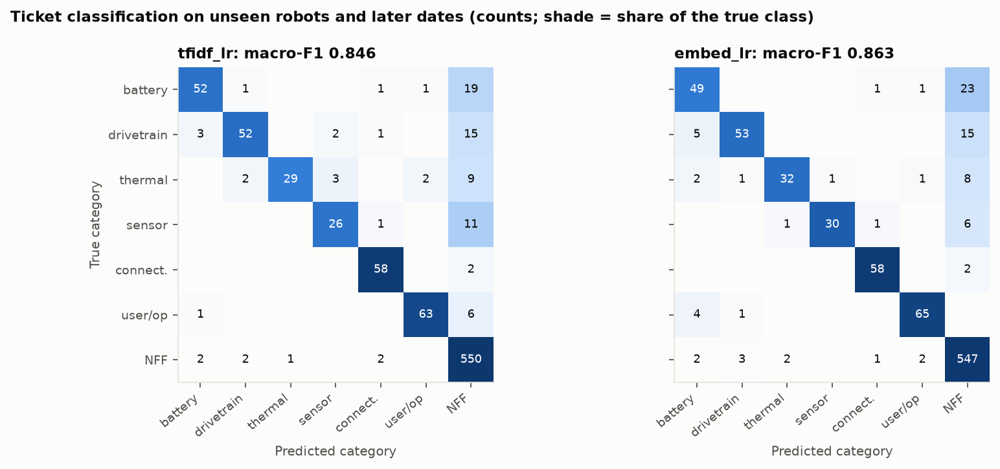
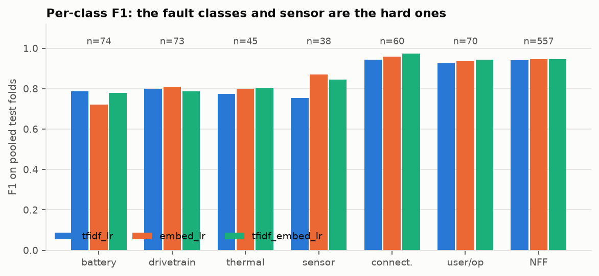

# W03 — Maintenance-Log Corpus and Ticket Classifier

*Week 3 deliverable 1 · generated by scripts/build_w03_docs.py from reports/w03/text_classifier_results.json and paraphrase_results.json · MLflow run 3da22b63425f49d1b18ca1725acb1813*

> **SYNTHETIC DATA.** Every ticket and note in this corpus was generated by code in this repository from templates, rule-based paraphrase and seeded noise, tied to the simulated fleet's ground truth. No InGen ticket, operator, customer or personal text was used or seen. The corpus is regenerable from a seed.

## 1. What the corpus is

1,371 documents for the 50-unit synthetic Aido Rover fleet (simulator v0.2, 60 days): 1,226 operator notes and 145 service tickets. Generator v0.1, seed 303, config SHA-256 `bdfde080530af531…`, tied to simulator config `6eb4d556b93e8690…`.

| Label (fixed taxonomy) | Documents | Share |
|---|---|---|
| battery | 92 | 6.7 % |
| drivetrain | 101 | 7.4 % |
| thermal | 64 | 4.7 % |
| sensor | 54 | 3.9 % |
| connectivity | 97 | 7.1 % |
| user/op. error | 98 | 7.1 % |
| no fault found | 865 | 63.1 % |

Why each document exists (the hidden `ground_truth/log_corpus_truth.csv`, used for analysis only, never as a model input):

| Source | Documents | Meaning |
|---|---|---|
| routine_note | 735 | handover / cleaning / inspection note unrelated to any fault |
| user_error | 98 | user or operational error (dock moved, wrong route loaded) |
| fault_symptom | 87 | operator symptom note during a simulated fault's P-F interval (notice probability rises with severity) |
| outage | 85 | connectivity ticket tied to a simulated network outage |
| nff_complaint | 66 | complaint on a healthy unit (70 % hedged, 30 % reads like a real symptom) |
| nff_closure | 64 | 'no fault found' closure of such a complaint |
| minor_sensor | 42 | text-only minor issue (lidar lens, bumper, encoder, IMU) |
| minor_drivetrain | 39 | text-only minor issue (worn tread, debris) |
| fault_service_close | 38 | work order closed by the repair |
| fault_service_open | 38 | work order opened after the fault was detected |
| minor_thermal | 31 | text-only minor issue (clogged intake filter) |
| minor_battery | 24 | text-only minor issue (dirty contacts, dock pins) |
| connectivity_misc | 12 | text-only connectivity issue (access-point handover, SIM) |
| drift_symptom | 7 | operator note about a drifting motor-temperature sensor (30 % worded as 'running hot') |
| drift_service | 5 | recalibration / replacement ticket for a drifting sensor |

Only **23** operator notes describe a fault *before* its qualifying onset. This is the number that bounds what text can add to a 72-hour early warning (see W03_Fusion_Results).

## 2. How it is generated (and how to regenerate it)

- **Events, not text, come first.** The generator plays the people around the robots: it reads the simulator's fault timelines, sensor-drift impairments and network outages, and decides *whether and when* someone writes. A symptom note is written in a 12-hour slot with probability `notice_rate x severity^1.5` (people notice late), only during staffed hours (06–20 UTC).
- **Text from templates.** Each source has several core phrases per category plus slot values (side, component, time of day), prefixes and suffixes (`templates.py`).
- **Deliberate noise** (`noise.py`, rates in `configs/maintenance_logs.yaml`): rule-based synonym paraphrase, abbreviations (35 % of eligible words), typos (6 % of words of 4+ letters), casing, dropped punctuation, unit mentions; 25 % of fault notes are vague ('acting weird again'), 10 % describe the symptom with another subsystem's words, 'no fault found' complaints and closures, and notes unrelated to any fault.
- **Label timing.** Every document has `created_at_utc` (when a feature may see it) and `label_available_utc` (when triage or the closing repair confirms the category). A label is used for training only if it was available by the training cut-off.
- **Held-out wording.** 20 % of core phrases are reserved (`unseen_phrase_ids` in the manifest) for the lexical-shift test in Section 4.

Regenerate (about 10 s): `uv run python -m ingen_fleet_health.text.corpus --data-dir data/w02`. The operator notice rate was fixed before any fusion result existed; Section 4 of W03_Fusion_Results repeats the fusion at 0.5x, 2x and 4x that rate.

## 3. Ticket classifier: protocol

Same split discipline as Week 2: 20 folds = cut-off days [20, 30, 40, 50] x 5 unit groups. Training tickets: units not in the test group and label_available_utc <= cutoff - 72 h. Test tickets: units in the test group and cutoff <= created_at_utc < cutoff + 10 d. No test-unit ticket and no label confirmed after the training cut-off is ever used for fitting. 917 test tickets in total.

- `majority` — always the most frequent training class (no-skill reference).
- `tfidf_lr` — baseline: word 1–2-gram + character 2–5-gram TF-IDF, class-balanced logistic regression.
- `embed_lr` — frozen `sentence-transformers/all-MiniLM-L6-v2` sentence embeddings (local, open weights), logistic regression.
- `tfidf_embed_lr` — both feature blocks side by side.
- C is chosen from [1.0, 10.0, 100.0, 1000.0] by leave-one-training-group-out macro-F1 *inside* the training tickets; the kind with the best such score is `selected` for the fold (chosen: tfidf_embed_lr in 17 folds, embed_lr in 3 folds).

## 4. Results on the held-out period

| Model | Macro-F1 | 95 % CI (unit bootstrap) | Accuracy |
|---|---|---|---|
| majority | 0.108 | [0.103, 0.113] | 0.607 |
| tfidf_lr | 0.846 | [0.815, 0.878] | 0.905 |
| embed_lr | 0.863 | [0.833, 0.892] | 0.909 |
| tfidf_embed_lr | 0.868 | [0.839, 0.897] | 0.914 |
| selected | 0.872 | [0.843, 0.901] | 0.917 |

| Paired comparison (same tickets) | Δ macro-F1 | 95 % CI | Reading |
|---|---|---|---|
| embed_lr − tfidf_lr | +0.016 | [-0.006, 0.038] | no detectable difference (interval contains 0) |
| tfidf_embed_lr − tfidf_lr | +0.022 | [0.007, 0.039] | better (interval above 0) |
| tfidf_lr − majority | +0.739 | [0.708, 0.769] | better (interval above 0) |

The TF-IDF baseline is already strong (macro-F1 0.846). Sentence embeddings alone add +0.016 [-0.006, 0.038], i.e. no detectable difference (interval contains 0); combining both adds +0.022 [0.007, 0.039], i.e. better (interval above 0). Macro-F1 weights the seven classes equally; 557 of 917 test tickets are 'no fault found', which is why accuracy is much higher than the majority baseline's macro-F1 suggests.

*Confusion matrices on the held-out period (rows: true label, columns: prediction).*

*Per-class F1 by model.*

| Class (selected model) | Precision | Recall | F1 | Support |
|---|---|---|---|---|
| battery | 0.881 | 0.703 | 0.782 | 74 |
| drivetrain | 0.897 | 0.712 | 0.794 | 73 |
| thermal | 0.941 | 0.711 | 0.810 | 45 |
| sensor | 0.909 | 0.789 | 0.845 | 38 |
| connectivity | 0.983 | 0.967 | 0.975 | 60 |
| user/op. error | 0.957 | 0.943 | 0.950 | 70 |
| no fault found | 0.911 | 0.989 | 0.948 | 557 |

### Which categories are confused, and why

Error analysis of the combined model `tfidf_embed_lr` (the per-fold choice in 17 of 20 folds):

| True → predicted | Count | Where the errors come from (hidden source; style) | Example (synthetic) |
|---|---|---|---|
| battery → no fault found | 21 | fault_symptom 18, fault_service_close 2, minor_battery 1; specific 16, vague 5 | takes much longer to reach full chg tan the oter units |
| drivetrain → no fault found | 17 | fault_symptom 12, fault_service_open 3, fault_service_close 2; specific 12, vague 3, misattributed 2 | After the morning round battery seems to drain faster, runtime shorter than last week |
| thermal → no fault found | 8 | fault_symptom 8; specific 6, vague 2 | Motor housing very hot to the touch after patrol logging for maintenance |
| sensor → no fault found | 7 | drift_symptom 5, minor_sensor 2; specific 4, misattributed 3 | R018 - mtr temperature high on the dashboard again |
| no fault found → drivetrain | 3 | nff_complaint 3; hedged 2, specific 1 | Note for maintenance: customer reports metallic scraping sound near the rear right axle, n |
| drivetrain → battery | 3 | fault_symptom 3; vague 3 | Issue again, see earlir note |

- **The fault categories leak into 'no fault found'.** Almost every large error is a battery, drivetrain, thermal or sensor ticket predicted as 'no fault found'. Accuracy on early *fault symptom notes* is 33 % (n = 73), against 100 % on routine notes and 88 % on work orders. A first symptom note and a 'no fault found' complaint use the same everyday words ('takes longer to charge', 'hot smell'); only the later outcome tells them apart, and the class prior (about 60 % 'no fault found') decides the tie.
- **Vague notes cannot be classified** (6 % correct, n = 18): 'issue again, see earlier note' carries no category. This is a property of the text, not of the model; it needs the unit's earlier notes or telemetry as context.
- **Misattributed notes are read literally** (42 % correct, n = 12): a drivetrain fault described as 'battery seems to drain faster' is classified as what it says. Sensor drift reported as 'running hot' is the clearest case (drift symptom accuracy 0 %, n = 6).
- **Typos barely matter** (91 % with none, 87 % with two or more): character n-grams and subword embeddings absorb them.

**Implication for fusion.** The classifier is most reliable on documents that arrive *after* a fault is known (work orders, closures, routine notes) and least reliable on the early symptom notes an early-warning model would need. Its headline macro-F1 therefore overstates how much it can help predict a fault 72 h ahead.

### Wording never seen in training (lexical shift)

A second run removes from training every ticket built from a held-out core phrase; test tickets with those phrases measure generalisation to new wording.

| Model | Macro-F1, seen wording | Macro-F1, unseen wording |
|---|---|---|
| majority | 0.107 | 0.112 |
| tfidf_lr | 0.846 | 0.393 |
| embed_lr | 0.873 | 0.475 |
| tfidf_embed_lr | 0.882 | 0.449 |
| selected | 0.887 | 0.481 |

On unseen wording (151 tickets) macro-F1 drops to 0.393 for TF-IDF and 0.475 for embeddings: both lose about half their skill, so on a template corpus the in-distribution score largely measures template recall. Embeddings score higher on new wording, but paired on the same tickets the difference is +0.082 [-0.032, 0.192]: no detectable difference (interval contains 0), so the 151 tickets cannot establish it.

### Local-LLM paraphrase robustness

Plan v3.0 asks for LLM-assisted paraphrase. The training corpus stays template-only (so it regenerates without a 3 GB model). Instead 210 test tickets (up to 30 per class, seed 0) were rewritten by the local open-weights model `Qwen/Qwen2.5-1.5B-Instruct` (greedy, max 64 new tokens, repetition_penalty 1.05; no hosted API) and scored by the same fold classifiers. Refitting reproduced the original out-of-fold predictions for 100 % of the sample. Median token Jaccard between original and rewrite: 0.25 (the rewrites really change the wording). MLflow run 794f0ed917eb490ab661e1dbd5fd3246.

| Model | Macro-F1 original | Macro-F1 rewrite | Δ | 95 % CI | Prediction unchanged |
|---|---|---|---|---|---|
| tfidf_lr | 0.824 | 0.823 | -0.000 | [-0.039, 0.035] | 88 % |
| embed_lr | 0.837 | 0.838 | +0.001 | [-0.031, 0.033] | 87 % |
| tfidf_embed_lr | 0.845 | 0.855 | +0.010 | [-0.019, 0.038] | 91 % |
| selected | 0.848 | 0.851 | +0.002 | [-0.026, 0.032] | 90 % |

**Reading.** For the selected model the change is +0.002 [-0.026, 0.032]: no detectable drop. The local model's rewrites keep the category keywords ('battery', 'vibration', 'connection') and also remove the deliberate typos, so they are a weaker shift than the held-out-wording test above, which is the harder and more informative robustness check.

**Check of 30 randomly drawn pairs** (read once by the AI assistant that built the pipeline; not reviewed further): 21 kept meaning and category, 6 kept the category but changed a detail, 3 changed the meaning (meaning changes: 'returns to dock early' became 'departs from dock prematurely', a battery SoH note became 'display malfunctioned', 'kept in service' became 'removal from service'; detail changes: 'BRG' expanded to 'bracket', 'blown out' became 'need to clean', 'charger' dropped, a cause or an instruction added). The label of a rewrite is the label of its original, so some measured errors on rewrites are label noise introduced by the LLM, not classifier errors.

Examples where the selected model was right on the original and wrong on the rewrite:

| Label | Original (synthetic) | Local-LLM rewrite | Predicted |
|---|---|---|---|
| battery | Day shift did not finish the full patrol loop low battery warning at 25% please  | The day shift team failed to complete the entire patrol loop due to a low battery warning  | no fault found |
| battery | Did not chg fully, maybe it was not docked right. will monitor | The change did not occur completely, possibly because it was not properly docked. I will k | user/op. error |
| drivetrain | PLASTIC WRAP TAGNLED AROUND THE AXEL - SAME AS LAST SHIFT | PLASTIC TAG ON AXLE END IS WEARING OUT - SAME AS PREVIOUS SHIFT | no fault found |
| drivetrain | batt seems to drain faster runtime shorter than last week | battery consumption appears to be increasing at a rate faster than usual during this perio | battery |
| thermal | HOT SMELL COMING FROM THE MOTOR BAY - PLS CHECK | SMELL OF HOT AIR FROM ENGINE AREA - PLEASE INSPECT | no fault found |
| thermal | Cooling fan swapped, heat sink cleaned, tempeeratures back in range. | Fan replaced, heatsink serviced, temperatures within acceptable limits. | no fault found |

## 5. Limitations

- The corpus is template-generated; real maintenance text is longer-tailed, refers to earlier conversations and uses site-specific jargon. All scores here are upper bounds on template recall, and the lexical-shift and paraphrase tests show how fast they fall.
- Labels are clean by construction (the generator knows why each note exists). Real ticket categories are assigned by people and are noisy.
- The operator notice rate is an assumption; its effect on fusion is measured in W03_Fusion_Results, Section 4.
- No hosted LLM was used (no key, no cost approval, no data-handling decision). The paraphrase test uses a 1.5 B-parameter local model; a stronger model would produce more varied rewrites.
